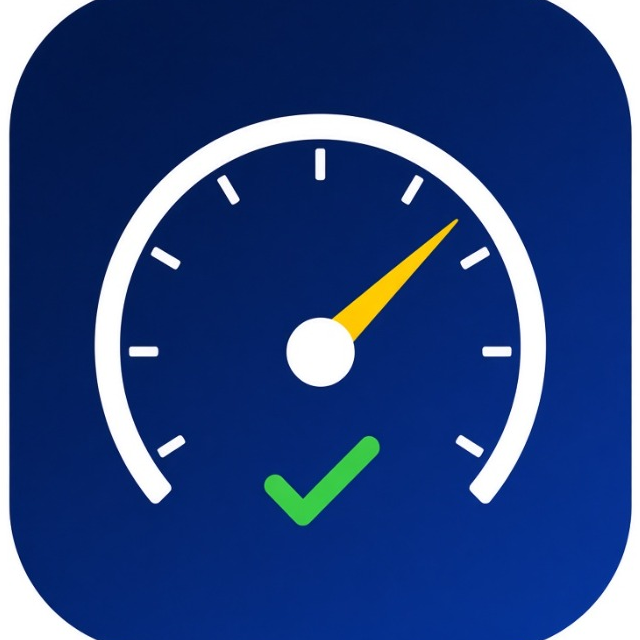

# SpeedCheck 🇬🇭

<p align="center">
  
  <br>
  <b>Smart Road Safety & Automated Speed Camera Alert App for Drivers in Ghana</b>
  <br><br>
  <a href="https://github.com/cosmicagbey/speedcheck/releases/latest">
    
  </a>
  <a href="https://github.com/cosmicagbey/speedcheck/actions">
    
  </a>
</p>

---

## 📲 How to Download & Try

1. On your Android phone, tap the download link:  
   👉 **[Download SpeedCheck.apk (Latest Version)](https://github.com/cosmicagbey/speedcheck/releases/latest)**
2. Tap the downloaded file to install it. (If Android asks, enable *"Install unknown apps"* for your browser).
3. Open **SpeedCheck**, grant the Location permissions (choose *"Allow all the time"* so it protects you with the screen off), and tap **START MONITORING**!

---

## 🚀 Key Features

### 1. 📷 Auto-Detect Speed Limits & Camera Radar
- **Automatic Camera Corridor Detection**: Detects your GPS position and heading as you drive towards speed camera traps in Accra, announces the zone, and automatically adjusts your speed limit:
  1. **Borteyman Sports Facility T-Junction** (Limit: **80 km/h**)
  2. **The N1 Highway near Fiesta Royale Hotel** (Limit: **80 km/h**)
  3. **The N1 Highway near Baah Junction / Bar Junction** (Limit: **80 km/h**)
  4. **Kawukudi (Olusegun Obasanjo Highway)** (Limit: **50 km/h**)
  5. **Kanda Highway** (Limit: **50 km/h**)
- **Live Distance Countdown**: Shows your real-time distance from approaching cameras (e.g., *"📍 N1 Fiesta Royale • 450m ahead"*).
- **One-Touch Toggle**: Easily switch between **Auto-Detect** mode and **Manual** mode with a single tap on the Dashboard.

### 2. 🗣️ Proactive Voice Alerts (Text-to-Speech)
- **Early Approaching Alert**: Warns you *before* reaching the speed limit so you don't accidentally get ticketed:
  - *Example*: In a 30 km/h zone, triggers at **25 km/h**:
    > *"You are approaching 30 kilometers per hour."*
- **Over-Limit Warning**: Triggers immediately if speed exceeds the limit:
  > *"Slow down. Current speed is above your limit."*
- **Voice Customization**: Choose between Female, Male, or System voice styles with speed rate and pitch controls.
- **Anti-Spam Cooldown**: Alerts repeat at configurable intervals (10s, 15s, 20s, 30s) while over the limit to avoid spamming the driver.
- **Loud & Clear Audio**: Uses Android `USAGE_ASSISTANCE_NAVIGATION_GUIDANCE` to ensure alerts are loud and clearly heard over road and car noise.

### 3. 🔋 Silent Background Operation
- **Works with Screen Off**: Protects the driver silently in the pocket or dashboard mount even when the screen is locked or another navigation app (Google Maps, Waze) is active.
- **Smart Vehicle Movement Detection**:
  - Automatically detects when you are in a moving vehicle (speed consistently > ~18 km/h).
  - Automatically transitions to high-frequency active tracking.
  - Pauses to low-power mode when stationary for extended periods to conserve battery.
- **Auto-Resume on Boot**: Automatically restores background monitoring after phone restart if configured.
- **Persistent Minimal Notification**: Compliant with Android foreground service guidelines with quick "Stop Monitoring" button.

### 4. 🎛️ Manual Speed Limits & Ghana Presets
- One-tap speed limit selection matching Ghana Road Safety standards:
  - **30 km/h**: School zones, busy market corridors, hospital areas, and residential feeder roads.
  - **50 km/h**: Standard urban roads and town centers (Accra, Kumasi, Takoradi).
  - **80 km/h**: Inter-urban highways and single-lane regional roads.
  - **100 km/h**: National dual-carriageway highways (e.g. N1 George Walker Bush Highway).
  - **120 km/h**: Expressways and motorways (Accra-Tema Motorway).
- **Custom Limit Input**: Type any custom speed limit (e.g. 40, 60, 70, 90 km/h).

### 5. 📊 High-Contrast Driving Dashboard
- Large digital speedometer readout designed for glanceability while driving.
- Custom Canvas arc gauge with color states:
  - 🟢 **Safe** (Emerald Green)
  - 🟡 **Approaching Limit** (Amber Yellow)
  - 🔴 **Over Speed Limit** (Pulsing Red)
- Real-time Trip Statistics: Max speed, average speed, and total trip distance.
- One-touch voice mute/unmute toggle on the top bar.

---

## 🛠️ Tech Stack & Architecture

- **Language**: Kotlin 2.3+
- **Minimum SDK**: Android 8.0 (API 26)
- **Target SDK**: Android 15/16 (API 36)
- **UI Toolkit**: Jetpack Compose with Material 3 & Navigation3
- **Location Engine**: Google Play Services Location (`FusedLocationProviderClient`)
- **Speech Engine**: Android Text-to-Speech (`TextToSpeech`)
- **Persistence**: Jetpack DataStore Preferences
- **Concurrency**: Kotlin Coroutines & StateFlow
- **CI/CD**: GitHub Actions workflow for automatic APK building and Release distribution

---

## 💻 Building Locally (For Developers)

```bash
git clone https://github.com/cosmicagbey/speedcheck.git
cd speedcheck
./gradlew test
./gradlew assembleDebug
```
The output APK will be generated at `app/build/outputs/apk/debug/app-debug.apk`.

---

## 📱 Permissions Used

| Permission | Purpose |
| :--- | :--- |
| `ACCESS_FINE_LOCATION` | Required for accurate GPS vehicle speed calculation. |
| `ACCESS_COARSE_LOCATION` | Fallback network location. |
| `ACCESS_BACKGROUND_LOCATION` | Allows tracking speed and giving voice warnings while screen is off. |
| `FOREGROUND_SERVICE` & `FOREGROUND_SERVICE_LOCATION` | Keeps the speed monitoring service alive in the background. |
| `POST_NOTIFICATIONS` | Displays the ongoing speed status notification and heads-up warnings. |
| `RECEIVE_BOOT_COMPLETED` | Automatically resumes speed monitoring when device reboots (if enabled). |
| `WAKE_LOCK` | Prevents the CPU from sleeping during active driving sessions. |

---

## 🇬🇭 Ghana Road Safety & MTTD Speed Enforcement Tips

1. **George Walker Bush Highway (N1)**: 80–90 km/h speed cameras installed near footbridges and major interchanges (Fiesta Royale, Dzorwulu, Abeka Lapaz, Baah Junction).
2. **Accra-Tema Motorway & Borteyman**: 80–100 km/h cameras active for overspeeding enforcement.
3. **Kawukudi & Kanda Highways**: Strictly 50 km/h urban arterial enforcement.
4. **School & Hospital Zones**: Strictly 30 km/h.

---

## 🔒 Privacy & Data Policy

SpeedCheck does **not** track personal identifiers or sell data. No advertising identifier (AAID) is used, and no location data ever leaves your device.  
Read the full document: **[Privacy Policy](PRIVACY_POLICY.md)**.

---

## 🚀 Google Play Closed Testing

For Google Play Console tracks:
* **Android App Bundle (.aab)**: Built automatically by `./gradlew bundleRelease` and attached to every GitHub Release.
* **Upload Keystore**: Located at `keystore/upload-keystore.jks` (alias: `speedcheck`).
